# MetroGym Website

WEDE5020 (Web Development — Introduction) — Portfolio of Evidence

- **Live website:** https://phawu6-spec.github.io/metrogym/
- **Repository:** https://github.com/phawu6-spec/metrogym

## Student Information

- **Name:** Phawu Zotwa
- **Institution:** Rosebank International (IIE)
- **Module:** WEDE5020 — Web Development (Introduction)
- **Assessment:** Portfolio of Evidence (PoE)

## Project Overview

MetroGym is a fictional functional-fitness and CrossFit-style gym on Cape Road, Gqeberha, founded in 2016 by Asavela Kahla. This repository holds the source code for MetroGym's first website, built across the three parts of the PoE:

- **Part 1 — Building the Foundation:** planning, research and HTML structure. *(complete)*
- **Part 2 — Designing the Visuals:** CSS styling and responsive design. *(complete)*
- **Part 3 — Adding Functionality and SEO:** JavaScript features, validated forms, SEO, deployment. *(this submission)*

**Storyline:** a visitor finds MetroGym in a search, compares classes, checks today's timetable, asks about one class (cost and availability), and books a free first class — or sends a general message.

## Website Goals and Objectives

- Increase the number of free trial class bookings generated online.
- Provide an always-available source for class schedules, prices and location, reducing repetitive phone and walk-in questions.
- Build community credibility through consistent, professional branding.

**Key Performance Indicators (KPIs):** trial-class enquiries submitted per month; unique visitors to the classes page; enquiry form completion rate.

## Key Features and Functionality (Part 3)

| Feature | Page | What it does | Where in the code |
|---|---|---|---|
| Dynamic content — "What's On Today" | `index.html` | Reads `data/classes.json` and the clock (gym time zone) to list today's classes, mark the next one, and show an Open / Closed badge | `initTodayWidget`, `openStatus` in `js/script.js` |
| Search, filter and sort | `services.html` | Search by keyword; filter by level and time of day; sort by name or price; live result count and an empty-state message | `initClassExplorer` |
| Accordion | `services.html` | FAQ answers open and close with an animated height; one open at a time; keyboard and screen-reader friendly (`aria-expanded`) | `initAccordion` |
| Today's row highlight | `services.html` | Highlights the current day in the timetable (DOM manipulation) | `initScheduleHighlight` |
| Image gallery + lightbox | `about.html` | Click a thumbnail to view the large photo with next / previous, close button, Esc and arrow keys, and swipe on touch screens | `initGallery` |
| Interactive map (Leaflet + OpenStreetMap) | `contact.html` | Two locations with popups; zoom and pan; buttons fly the map to each location; usable on mobile | `initMap` |
| Animation | all pages | Scroll-reveal fade/slide on cards, accordion height transition, lightbox fade, card hover and pop-in on filtered cards; switched off for users who prefer reduced motion | `initReveal`, `css/style.css` |
| Mobile navigation | all pages | CSS-only toggle plus JS that closes the menu after a link is chosen or on Esc and keeps `aria-expanded` in sync | `initNav` |
| Enquiry form | `enquiry.html` | See below | `initEnquiryForm` |
| Contact form | `contact.html` | See below | `initContactForm` |

### Forms — two different purposes

| | `enquiry.html` | `contact.html` |
|---|---|---|
| Purpose | Ask about **one class**: cost and availability | **General** message to the gym |
| Fields | Name, email, phone (optional), class, preferred time (radio), start date, notes with counter, consent checkbox | Name, email, phone (optional), message type (select), subject, message with counter, preferred reply method (radio) |
| `action` | `mailto:info@metrogym.co.za` | `mailto:info@metrogym.co.za` |
| After valid input | Fetches `data/classes.json` (AJAX, no page reload), then shows monthly cost, the session on the chosen date, and spots left (or a waiting-list message). A button emails the enquiry to the gym | Compiles the details into an email addressed to the recipient set in `RECIPIENT_EMAIL` (top of `js/script.js`) and opens the visitor's email app, with a button as backup |
| Storyline rules | The class must actually run on the chosen date and time slot (e.g. Strength & Conditioning only runs Mon/Wed evenings); no Sundays; date within the next 60 days | Phone number becomes required when "reply by phone" is chosen |

**Validation (both forms):** HTML5 attributes (`required`, `type=email`, `minlength`, `maxlength`, `pattern`, `min`, `max`) are in the markup and JavaScript checks the same rules and shows a plain-language message next to the field, moves focus to the first problem, and re-checks fields as they are corrected. Without JavaScript the browser's own HTML5 validation still applies. South African phone format: `082 123 4567` or `+27 82 123 4567`.

## SEO

**On-page**

| Page | Title | Main keywords |
|---|---|---|
| `index.html` | MetroGym \| Functional Fitness Gym in Gqeberha | functional fitness Gqeberha, CrossFit Gqeberha, gym Gqeberha |
| `about.html` | About MetroGym \| Coach-Led Fitness in Gqeberha Since 2016 | about MetroGym, Asavela Kahla, gym history Gqeberha |
| `services.html` | Classes, Schedule & Prices \| MetroGym Gqeberha | gym classes Gqeberha, class schedule, MetroFit, gym prices Gqeberha |
| `enquiry.html` | Class Enquiry & Free Trial \| MetroGym Gqeberha | free trial class, book fitness class, class availability |
| `contact.html` | Contact & Map \| MetroGym Cape Road, Gqeberha | contact MetroGym, gym Cape Road Gqeberha, gym opening hours |

- Unique `<title>`, `meta description` (about 140–160 characters), `meta keywords` and `author` on every page.
- One `<h1>` per page with logical `<h2>`/`<h3>` headings; class details are plain HTML so search engines can read them (JavaScript only enhances them).
- Descriptive image file names (e.g. `gym-exterior.png`) and accurate `alt` text on every image; `width`/`height` set to avoid layout shift; below-the-fold images use `loading="lazy"`.
- Clean, readable URLs (`/services.html`, `/contact.html`) and internal links with meaningful anchor text (e.g. "class schedule and prices", "Book a free trial class") in the body and footer.
- Mobile-friendly: viewport meta tag and responsive layout at tablet and phone widths (see screenshots below).

**Technical**

- `canonical` link, Open Graph and Twitter preview tags on every page.
- `sitemap.xml` and `robots.txt` in the site root.
- JSON-LD structured data (`ExerciseGym`) with address, opening hours, founder and price range on the home and contact pages.
- Fonts load through `<link>` (with `preconnect`) instead of a CSS `@import`; photos were resized and compressed from about 2.2 MB to about 0.55 MB in total with the same file names.

**Off-page and local SEO (plan)** — MetroGym is a fictional organisation, so no external accounts exist yet. For a real launch the plan would be: claim a Google Business Profile using the same name, address and phone number shown on the site (consistent NAP details); share class news and the free-trial offer on social media with links back to the relevant page; and ask local partners such as sports clubs, physiotherapists and the founder's community networks for genuine links. No fake or purchased backlinks.

## Security

- Input is validated on length, format and range; user text is added to the page with `textContent` (never `innerHTML`), so HTML typed into a field is displayed as text, not run.
- A hidden honeypot field in both forms quietly ignores bot submissions.
- The only third-party script is Leaflet 1.9.4, pinned to an exact version and loaded with a Subresource Integrity hash and `crossorigin`.
- No API keys, passwords or credentials are stored in the repository. The map needs no key.
- The site is served over HTTPS by GitHub Pages.

## Accessibility and Performance

- Skip-to-content link, visible focus outlines, labelled form fields with error text linked by `aria-describedby`, `aria-live` regions for form results and result counts, and dialog roles on the lightbox.
- Muted text colour was lightened to meet readable contrast on the dark background.
- `prefers-reduced-motion` is respected.

## Responsive Design Evidence

Screenshots of every page at desktop (1280px), tablet (820px) and phone (390px) widths are in the `screenshots/` folder.

| Page | Desktop | Tablet | Mobile |
|---|---|---|---|
| Home | [index-desktop](screenshots/index-desktop.jpg) | [index-tablet](screenshots/index-tablet.jpg) | [index-mobile](screenshots/index-mobile.jpg) |
| About | [about-desktop](screenshots/about-desktop.jpg) | [about-tablet](screenshots/about-tablet.jpg) | [about-mobile](screenshots/about-mobile.jpg) |
| Classes | [services-desktop](screenshots/services-desktop.jpg) | [services-tablet](screenshots/services-tablet.jpg) | [services-mobile](screenshots/services-mobile.jpg) |
| Contact | [contact-desktop](screenshots/contact-desktop.jpg) | [contact-tablet](screenshots/contact-tablet.jpg) | [contact-mobile](screenshots/contact-mobile.jpg) |
| Enquiry | [enquiry-desktop](screenshots/enquiry-desktop.jpg) | [enquiry-tablet](screenshots/enquiry-tablet.jpg) | [enquiry-mobile](screenshots/enquiry-mobile.jpg) |

**Mobile — About, Contact and Home** (the About and Contact layouts were corrected after Part 2 feedback):

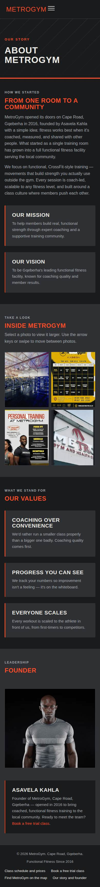
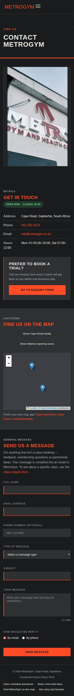

**Part 3 features working:**

| Feature | Screenshot |
|---|---|
| Search / filter / sort | 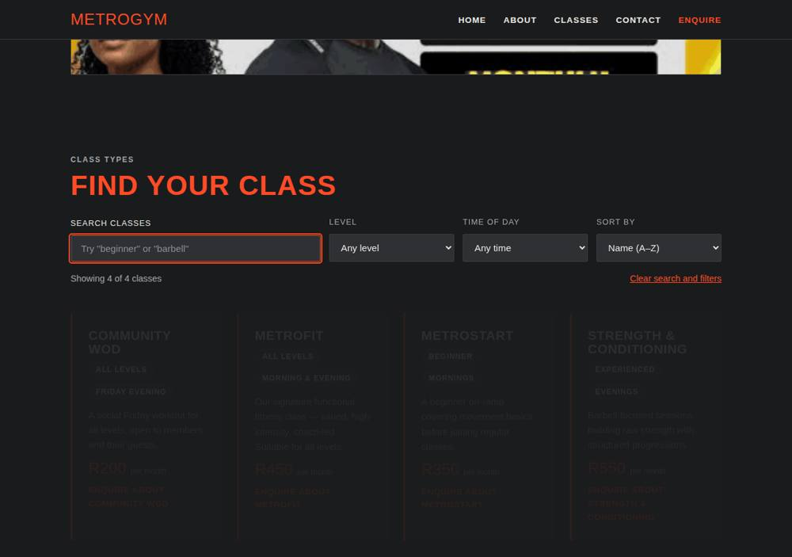 |
| Accordion | 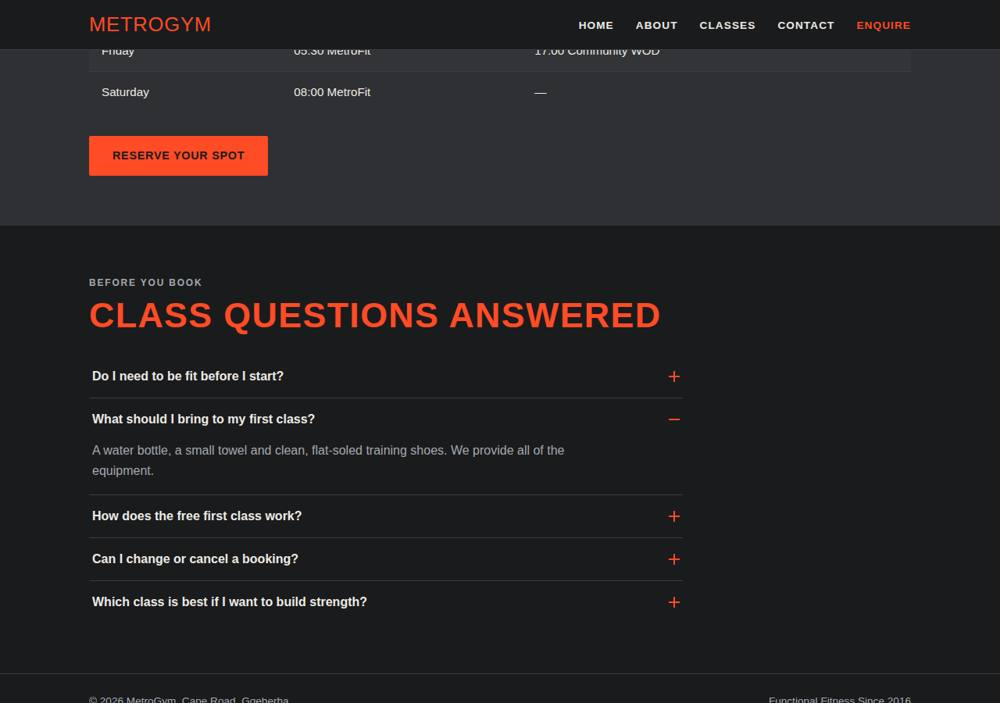 |
| Lightbox | 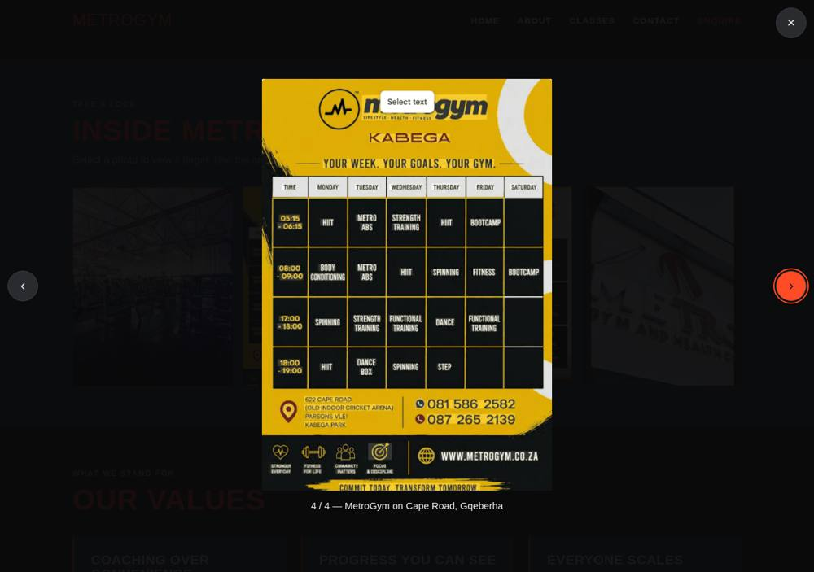 |
| Map with two locations | 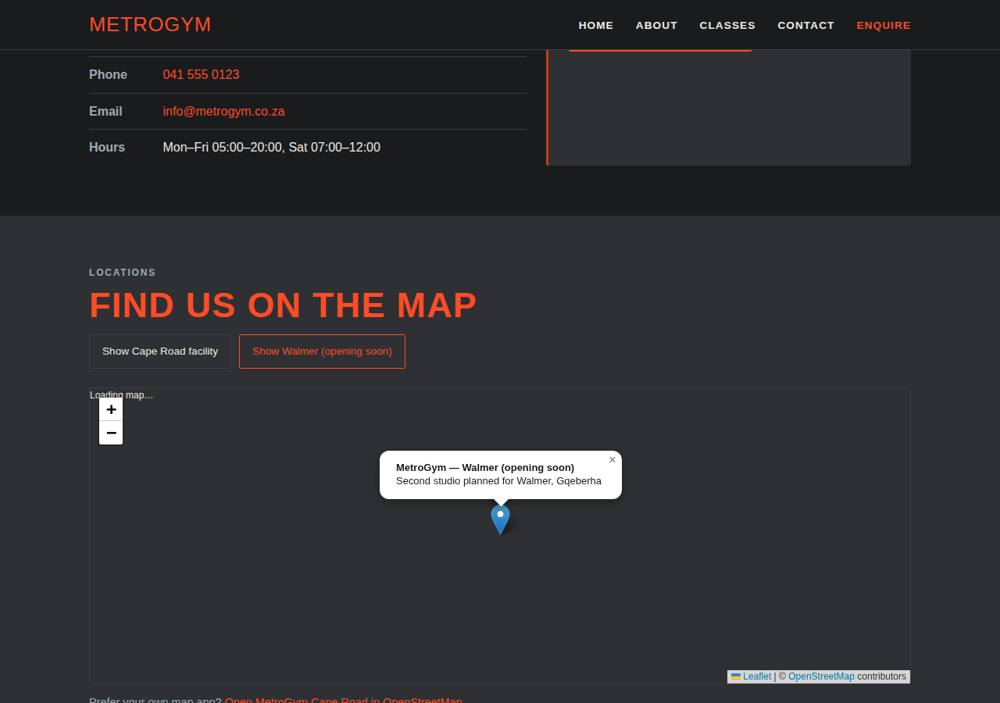 |
| Enquiry form — validation errors | 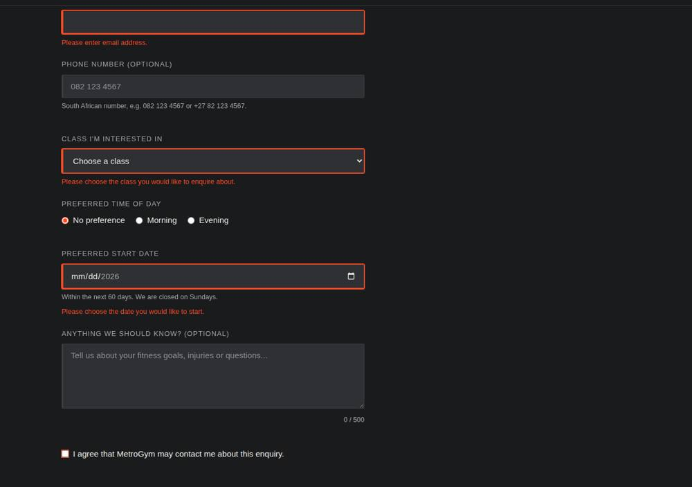 |
| Enquiry form — cost and availability | 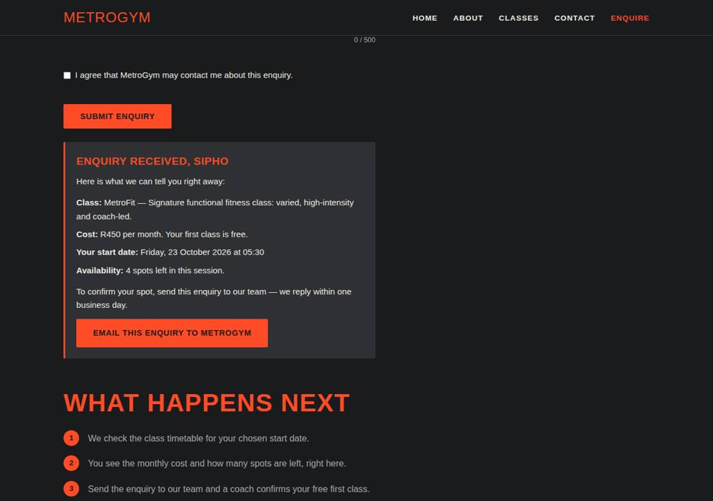 |
| Contact form — compiled email | 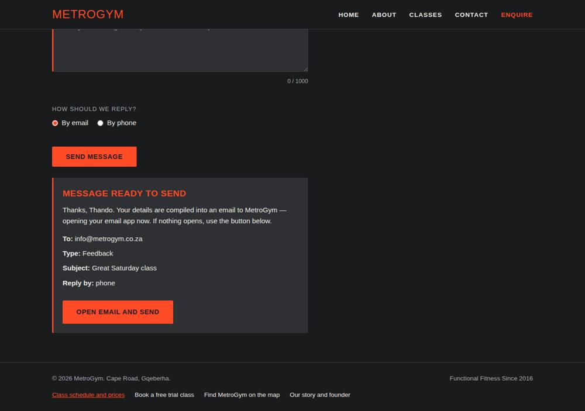 |
| Mobile menu open | 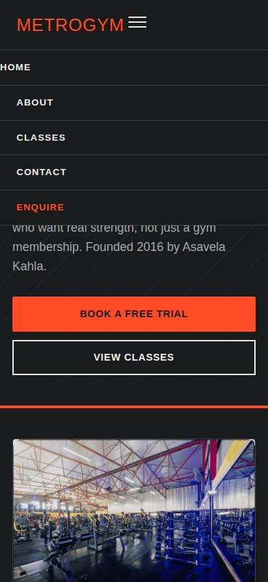 |

## Testing

An automated browser test (Playwright, Chromium) was run against the site on a local server at desktop, tablet and phone widths. **125 of 125 checks passed**, covering:

| Area | What was tested | Result |
|---|---|---|
| JavaScript | Search, filter and sort; accordion open/close; lightbox open, next, previous, wrap-around, Esc, close button (desktop and phone); map loads with two markers and popups; today widget at three different times (open, closed, Sunday) | Pass |
| Forms | Empty, invalid and valid input on both forms; wrong phone format; past and far-future dates; class/day mismatch; Sunday; phone required when "reply by phone"; waiting-list message; honeypot; HTML typed into a field is not run | Pass |
| AJAX | Data file blocked → friendly error and the button works again | Pass |
| SEO | Unique title, description length, one `h1`, `alt` on every image, canonical link on all five pages | Pass |
| Responsive | No horizontal scrolling on any page at 1280px and 390px; mobile menu opens and navigates | Pass |

## How to Run

1. Visit the live website above, **or**
2. Download or clone the repository and open `index.html`. Because the timetable and prices are loaded from `data/classes.json` with `fetch()`, run a simple local server for those features, e.g. `python -m http.server` in the project folder and open `http://localhost:8000/`. (Opening the file directly still shows every page; only the live timetable and the enquiry answer need the server.)

## Deployment

The site is published with **GitHub Pages** (Settings → Pages → Deploy from branch → `main` / root) at https://phawu6-spec.github.io/metrogym/. It is a static site, so no build step is needed.

## File and Folder Structure

```
metrogym/
├── index.html
├── about.html
├── services.html
├── enquiry.html
├── contact.html
├── robots.txt
├── sitemap.xml
├── README.md
├── css/
│   └── style.css
├── js/
│   └── script.js
├── data/
│   └── classes.json
├── images/
│   ├── hero-training.png
│   ├── about-facility.png
│   ├── founder-asavela-kahla.png
│   ├── class-session.png
│   ├── gym-exterior.png
│   └── logo-mark.png
├── wireframes/
│   └── (five page wireframes)
└── screenshots/
    └── (responsive and feature evidence)
```

## Sitemap

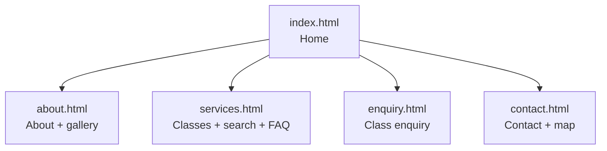

## Wireframes

Low-fidelity wireframes for all five pages are in `wireframes/` (`index`, `about`, `services`, `contact`, `enquiry`).

## Timeline and Milestones

| Milestone | Part | Date | Status |
|---|---|---|---|
| Research, sitemap, initial HTML structure | Part 1 | 14 Aug 2026 | ✅ Complete |
| Part 1 fixes (images folder, broken link, wireframes) | Part 1 | 17 Sep 2026 | ✅ Complete |
| External stylesheet, typography, layout, responsive CSS | Part 2 | 17 Sep 2026 | ✅ Complete |
| Part 2 feedback fixes, JavaScript features, forms, SEO, deployment | Part 3 | 22 Oct 2026 | ✅ Complete |

## Part 1 Details

Part 1 covered project initiation and planning: the Website Project Proposal (two organisation options), content research, the file and folder structure, and the initial semantic HTML for five pages (`header`, `nav`, `main`, `footer`) with comments and consistent indentation. Part 1 scored 84/100; its corrections (images folder, wireframes, broken `classes.html` link, `<main>` wrapper, truncated stylesheet) are recorded in the changelog.

## Part 2 Details

Part 2 covered CSS: external stylesheet shared by all pages, default styles, Bebas Neue and Inter typography with fluid `clamp()` sizes, Flexbox and Grid layout, a charcoal / concrete / chalk / orange palette with CSS variables, pseudo-classes, media queries, responsive typography, navigation and images. Part 2 scored 78/100; the feedback and how each point was handled is in the changelog below.

## Changelog

### Part 3 (22 October 2026) — Part 2 feedback corrections

Part 2 feedback: media queries and breakpoints 0/10; layout not responsive on About and Contact 2/5; pseudo-classes 6/10; GitHub commits 2.5/5; README missing responsiveness screenshots 2.5/5.

| Version | Area | Issue / Feedback | Change made | Reason / Result |
|---|---|---|---|---|
| v3.1 | Media queries | Breakpoints scored 0/10. The pages link to `css/style.css`, but that file had been cut off mid-rule and contained no media queries; the finished responsive CSS sat in a loose `style.css` in the repository root that no page loaded | Replaced `css/style.css` with the complete stylesheet (768px and 480px breakpoints) and added an explicit tablet breakpoint (769px–1024px) with its own grid, gallery and navigation rules. Deleted the loose root copy | The breakpoints now actually load. Verified in a browser at 1280px, 820px and 390px |
| v3.2 | Layout (About, Contact) | Layout not responsive on mobile | The two-column layouts on these pages used inline `style` attributes, which override media queries. Replaced them with `.grid-2` and `.grid-founder` classes that collapse to one column under 768px | Both pages now stack on phones with no sideways scrolling (tested at 390px) |
| v3.3 | Pseudo-classes | Apply all relevant effects | Added `:link`, `:visited`, `:hover`, `:active`, `:focus-visible` for links, buttons and navigation; `:hover`, `:disabled`, `:optional`, `:valid`, `:invalid`, `:placeholder-shown`, `:checked` and `:focus-within` for form controls; `:nth-child`, `:last-child`, `:first-of-type`, `:not()` for cards, tables and lists; `::placeholder` and `::selection` | Clear visual feedback for every interactive state, including keyboard users |
| v3.4 | GitHub commits | Only a few commits | Part 3 was committed in separate, descriptive commits (stylesheet, script, each page, data file, images, screenshots, SEO files, README) | The history shows the work step by step |
| v3.5 | README | No screenshots of responsiveness | Added desktop, tablet and phone screenshots of every page, plus feature screenshots (see above) | Evidence that the layouts adapt and the features work |
| v3.6 | Repository tidy-up | Loose duplicate images, `style.css` and `script.js` in the root | Removed the duplicates; every file now lives in `css/`, `js/` or `images/` | Matches the folder structure in the brief; no broken or doubled files |

### Part 3 (22 October 2026) — new work

| Version | Area | Change made | Reason / Result |
|---|---|---|---|
| v3.7 | JavaScript | Added today widget, class search/filter/sort, accordion, gallery + lightbox, Leaflet map, scroll animations, mobile-menu close behaviour | Meaningful interactivity that fits the gym storyline |
| v3.8 | Forms | Enquiry form (cost and availability via `fetch`) and contact form (compiled email); HTML5 attributes plus JavaScript validation; `action` attributes; honeypot | Two forms with different purposes and clear error handling |
| v3.9 | SEO | Unique titles and descriptions, keywords, canonical, Open Graph, `sitemap.xml`, `robots.txt`, JSON-LD, internal links, descriptive alt text, image sizes | Easier for search engines and people to find and understand the site |
| v3.10 | Performance | Compressed photos (about 2.2 MB → 0.55 MB, same file names), `<link>` font loading, `loading="lazy"`, image dimensions | Faster load and no layout jumps |
| v3.11 | Accessibility | Skip link, lighter muted text colour, ARIA states, reduced-motion support, tidy keyboard focus in the lightbox | Usable by more people |
| v3.12 | Content | Added mission and vision to the About page, a Community WOD class and prices (shared with the enquiry answers via `data/classes.json`) | One source of truth for prices and availability |

### Earlier changes

- **17 September 2026** — Part 2: responsive CSS, additional pseudo-classes, responsive images and typography. Part 1 fixes: populated `images/`, added `wireframes/`, corrected the `enquiry.html` navigation link, added the missing `<main>`, repaired the truncated stylesheet, rewrote the timeline.
- **14 August 2026** — Part 1: renamed `classes.html` to `services.html`, added semantic sections and comments, added `js/` and `images/` folders, wrote the Website Project Proposal and README.
- **11 August 2026** — Initial HTML pages and shared stylesheet pushed to GitHub.

## References

- Google Fonts (2026) *Bebas Neue* and *Inter* [font families]. Available at: https://fonts.google.com (Accessed: 22 October 2026).
- Agafonkin, V. (2023) *Leaflet 1.9.4* [JavaScript library]. Available at: https://leafletjs.com (Accessed: 22 October 2026).
- OpenStreetMap contributors (2026) *OpenStreetMap*. Available at: https://www.openstreetmap.org/copyright (Accessed: 22 October 2026).
- Mozilla Developer Network (2026) *Using the Fetch API*. Available at: https://developer.mozilla.org/en-US/docs/Web/API/Fetch_API/Using_Fetch (Accessed: 22 October 2026).
- Mozilla Developer Network (2026) *Client-side form validation*. Available at: https://developer.mozilla.org/en-US/docs/Learn_web_development/Extensions/Forms/Form_validation (Accessed: 22 October 2026).
- Mozilla Developer Network (2026) *Intersection Observer API*. Available at: https://developer.mozilla.org/en-US/docs/Web/API/Intersection_Observer_API (Accessed: 22 October 2026).
- Mozilla Developer Network (2026) *Pseudo-classes*. Available at: https://developer.mozilla.org/en-US/docs/Web/CSS/Pseudo-classes (Accessed: 22 October 2026).
- Mozilla Developer Network (2026) *Using media queries*. Available at: https://developer.mozilla.org/en-US/docs/Web/CSS/CSS_media_queries/Using_media_queries (Accessed: 22 October 2026).
- Google Search Central (2026) *SEO Starter Guide*. Available at: https://developers.google.com/search/docs/fundamentals/seo-starter-guide (Accessed: 22 October 2026).
- Schema.org (2026) *ExerciseGym*. Available at: https://schema.org/ExerciseGym (Accessed: 22 October 2026).
- W3C (2023) *Web Content Accessibility Guidelines (WCAG) 2.2*. Available at: https://www.w3.org/TR/WCAG22/ (Accessed: 22 October 2026).
- Majikijela, E. (2026) *Search Engine Optimization (SEO)* [PowerPoint presentation]. WEDE5020 Unit 7. Rosebank International.
- Majikijela, E. (2026) *Introduction to JavaScript, Variables, Functions, and jQuery Integration* [PowerPoint presentation]. WEDE5020 Unit 6. Rosebank International.
- Rosebank International (2026) *WEDE5020 POE Part 3 Requirements Guide* [PowerPoint presentation]. Rosebank International.
- W3Schools (2026) *HTML Forms*. Available at: https://www.w3schools.com/html/html_forms.asp (Accessed: 22 October 2026).
